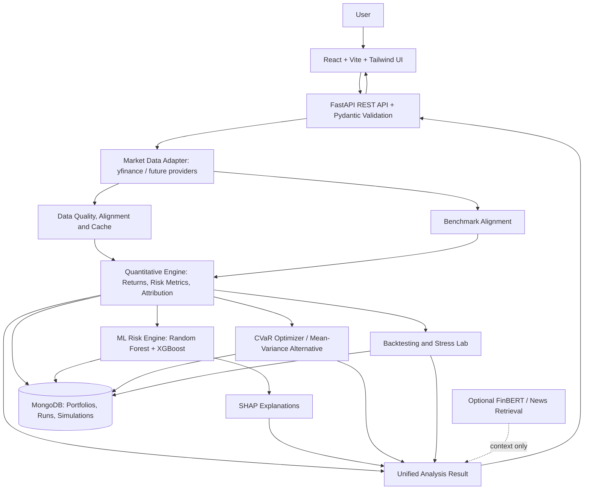

# RiskLens — Investment Risk Prediction System

> **TE/BE Fintech Project** · Implementation blueprint for AI-assisted development with Antigravity  
> **Tagline:** *See what drives your portfolio risk.*

## 1. Project Overview

**RiskLens** is an explainable investment-portfolio analysis platform. It evaluates the risk and historical performance of multi-asset portfolios, compares them with market benchmarks, suggests risk-aware allocations, and simulates how alternative strategies behave under historical and hypothetical market conditions.

The system is **not just a stock-price predictor or a risk-score generator**. It must show *why* a portfolio is considered risky, which holdings and exposures contribute to risk, how it compares with a benchmark, and how alternative allocations change the risk–return trade-off.

### Problem Statement (PS Summary)

Investors may find it difficult to judge portfolio risk because it depends on more than the assets selected. Historical returns, volatility, drawdowns, correlations, market conditions, concentration and portfolio allocation all matter. An apparently diversified portfolio may remain exposed to one sector or index, and strategies that performed well historically may behave differently in other market conditions.

**Build an ML-based web application** that accepts a portfolio and risk preference, analyses historical and latest available market data, predicts/classifies portfolio risk, recommends an improved allocation, compares results with relevant benchmarks, and simulates performance over selected historical periods. It must explain the main drivers of risk and return rather than showing an unexplained score.

### Required PS Coverage

- Add/select multiple assets and specify investment amounts or portfolio weights.
- Choose a preferred risk level and analyse historical performance and risk.
- Track holdings using the latest available market data.
- Classify overall portfolio risk as **Low, Medium or High**.
- Recommend a risk-aligned allocation and explain the trade-offs.
- Compare with relevant indices/benchmarks such as **NIFTY 50** or **NASDAQ-100**.
- Simulate different historical periods and compare portfolio strategies.
- Identify the assets, exposures and conditions contributing most to portfolio risk and return.

### Required Suggested Approach

1. **Portfolio Risk Prediction:** classify risk using returns, volatility, maximum drawdown, correlation and diversification, with explanations of material risk drivers.
2. **Asset Comparison and Allocation:** compare returns, volatility, drawdown, correlation and risk-adjusted performance; propose an allocation suitable for the selected risk preference.
3. **Historical Simulation:** calculate returns, volatility, drawdown and risk-adjusted metrics; plot portfolio growth and compare asset combinations across historical conditions.
4. **Current Tracking and Benchmark Comparison:** display prices, portfolio value, gains/losses, allocation and risk; compare portfolio and benchmark over the same dates and using consistent assumptions.
5. **Portfolio Strategy Comparison:** compare the original portfolio, recommended allocation, equal-weight portfolio and a relevant benchmark.

### Bonus Points to Implement

- **Dynamic Portfolio Adjustment:** instantly recompute results when risk preference, investment amount or assets change.
- **Risk–Return Visualization:** compare assets, portfolios and benchmarks through selectable historical periods.
- **Market Scenario Analysis:** model market declines, recoveries, high volatility and sector/asset-specific shocks.
- **AI-Based Market Intelligence:** optionally analyse relevant financial news, indicators and economic events to add sentiment context.
- **Explainable Recommendations:** state how volatility, correlation, concentration, diversification and risk contribution influence the recommended allocation.

---

## 2. Solution and Product Principles

RiskLens has five core actions:

1. **Measure** portfolio and asset risk with documented, reproducible quantitative calculations.
2. **Explain** portfolio-level risk with model explanations and separate quantitative asset-level risk attribution.
3. **Compare** original, equal-weight, recommended and benchmark portfolios on aligned dates.
4. **Explore** changes in assets, allocation, risk preference, rebalancing and market shocks.
5. **Disclose** market-data source/freshness, currency, date window, assumptions, model/method version and limitations.

**Key engineering rule:** the quantitative engine is the source of truth for every financial number. ML classifies risk; SHAP explains ML outputs; a quantitative risk-decomposition engine identifies asset contributions; optional GenAI/FinBERT adds context and must never invent or calculate portfolio metrics.

## 3. Tech Stack

| Layer | Technology | Responsibility |
|---|---|---|
| Frontend | React.js, JavaScript (ES6+), Vite | Portfolio input, dashboard, comparison and simulation UI |
| Styling | Tailwind CSS | Responsive layout and reusable UI styles |
| Charts | Recharts **or** Plotly.js | Growth curves, drawdown, allocations, risk/return and benchmark charts |
| Backend | Python, FastAPI, Uvicorn, Pydantic | REST APIs, validation and service orchestration |
| ML | scikit-learn, XGBoost | Random Forest primary model and XGBoost comparison model |
| Explainability | SHAP | Local/global explanation of ML predictions |
| Analytics | NumPy, pandas, SciPy | Returns, metrics, covariance, feature engineering and simulation |
| Optimization | CVXPY **or** PyPortfolioOpt | CVaR-first allocation optimization; mean-variance alternative |
| Database | MongoDB, PyMongo or MongoEngine | Users, portfolios, preferences, analysis runs and simulations |
| Market data | Yahoo Finance through `yfinance` | Historical/adjusted prices where available, latest available prices and benchmarks |
| Optional news NLP | FinBERT or equivalent financial sentiment model | Positive/neutral/negative sentiment for relevant news |
| Model persistence | Joblib | Save/load trained scikit-learn models and preprocessing objects |
| Developer tools | Git, GitHub, Postman, Python `venv`, `.env` | Version control, API testing and isolated configuration |
| Deployment | Vercel (frontend) + Render or equivalent (API) | Web hosting and Python API hosting |

**Data-source caveat:** `yfinance` is convenient for an educational prototype, but data freshness, availability, adjusted-price behaviour and permitted use can vary. Do not promise guaranteed real-time data. Keep the provider behind an adapter so it can be replaced later.

---

## 4. System Architecture

Use a **modular monolith** initially. Keep API routes, data providers, quantitative analytics, ML inference, optimization, backtesting and optional AI in separate modules; do not introduce microservices without a clear need.



### Core Data Flow

1. User enters assets/holdings, capital or weights, date range, benchmark and risk preference.
2. FastAPI validates tickers, dates, capital, constraints and request size.
3. Provider adapter fetches and caches market data; data-quality checks identify missing/stale values and mismatched dates.
4. The analytics engine aligns data and calculates returns, risk metrics, portfolio features and asset risk contributions.
5. Random Forest predicts risk; XGBoost is evaluated as a comparison model; SHAP explains the selected model prediction.
6. The optimizer produces constrained allocation alternatives. Backtesting and the Stress Lab evaluate scenarios.
7. The API returns one consistent analysis object for dashboard, comparison and export; saved runs include input assumptions, source timestamps and method/model versions.

### Suggested Repository Layout

```text
risklens/
├── frontend/
│   └── src/{app,components,features,lib,types}/
├── backend/
│   └── app/
│       ├── main.py
│       ├── api/v1/
│       ├── core/
│       ├── db/
│       ├── schemas/
│       ├── services/
│       ├── data/providers/
│       ├── quant/
│       ├── ml/
│       ├── ai/                 # optional news layer
│       └── reports/
├── tests/
├── models/                     # versioned model artifacts/model card
├── docs/
├── .env.example
├── README.md
└── docker-compose.yml          # optional local services
```

---

## 5. Core Features and Screens

### 5.1 Portfolio Builder

- Search/add/remove supported tickers and select asset quantities or target weights.
- Enter investment capital and currency; choose benchmark, date range and risk preference.
- Validate inputs and show unavailable assets or insufficient history clearly.

### 5.2 Portfolio Overview / Risk Dashboard

- Low/Medium/High risk class and calibrated/available class probabilities.
- Total value, gains/losses, return, annualized volatility, maximum drawdown, Sharpe, VaR and CVaR.
- Allocation breakdown, sector/concentration exposure, portfolio growth and benchmark overlay.
- Data freshness/source badge, analysis date range and warnings.

### 5.3 Asset Comparison

Compare assets using historical returns, volatility, drawdown, Sharpe/Sortino, beta, correlation and available data coverage.

### 5.4 Allocation Lab

- Compare original, equal-weight, optimized and benchmark strategies.
- Show current vs recommended weights and approximate amount per asset.
- Enforce long-only allocation by default, weight sum of 100%, configurable per-asset caps and optional sector limits.
- Explain why each suggested weight changes and present risk/return trade-offs.

### 5.5 Historical Backtesting

- Select start/end dates, initial capital, strategy and buy-and-hold or periodic rebalancing.
- Include configurable transaction costs where possible.
- Plot cumulative portfolio value, returns and drawdown; compare with a benchmark using the same date window and assumptions.

### 5.6 Stress Lab

- Apply user-defined market-wide, sector or single-asset shocks; volatility multipliers and recovery scenarios.
- Replay selected historical market periods where data is available.
- Clearly label hypothetical estimates versus observed historical results.

### 5.7 Optional Market Intelligence

Use FinBERT or a suitable financial sentiment classifier on retrieved, dated news about portfolio holdings or sectors. Show sentiment, headline/source/date and a short explanation. This is supplemental context only—not a predictor of certain price movements.

### 5.8 Save and Export

Save portfolio snapshots, analysis history, optimized portfolios and simulations in MongoDB. Export a PDF/CSV report containing assets/weights, benchmark, date window, metrics and definitions, source/freshness, model/method version, assumptions, warnings and an educational disclaimer.

---

## 6. MVPs and Unique Selling Points (USPs)

### MVP Delivery Scope

**MVP 1 — Trustworthy Portfolio Analysis**
- Portfolio builder and market-data adapter.
- Data-quality handling and core quantitative metrics.
- Risk dashboard, allocation visualization and benchmark comparison.

**MVP 2 — Explainable ML and Allocation**
- Random Forest risk classifier, XGBoost comparison, SHAP explanations.
- CVaR allocation optimization and original-vs-recommended comparison.

**MVP 3 — What-if Decision Support**
- Historical backtesting, strategy comparison and Stress Lab.
- Dynamic risk preference and allocation controls.
- Saved reports and optional FinBERT/news intelligence.

### Proposed Differentiating USPs

1. **Portfolio Risk DNA:** a readable breakdown of the main portfolio risk drivers—volatility, drawdown, tail loss, concentration and correlation.
2. **Risk Contribution Waterfall:** rank holdings by quantitative contribution to portfolio volatility/downside risk. Keep this separate from SHAP model feature explanations.
3. **Risk Budget Guardrails:** flag position/sector concentration, correlated holdings and constraints that exceed a user's selected risk preference.
4. **Market Regime Replay:** compare portfolio behaviour through bull, bear and high-volatility historical periods.
5. **Stress Lab:** test custom crashes, sector declines, volatility surges and recovery assumptions.
6. **“Why This Weight?” Explanations:** explain the inputs and constraints behind each allocation change, including trade-offs and uncertainty.
7. **Data Trust Meter / Provenance Passport:** show data freshness, missing observations, coverage, sources, assumptions and the model/method version behind the result.
8. **Risk–Return Trade-off Explorer:** dynamically compare original, equal-weight, recommended and benchmark strategies as the user changes assumptions.

These USPs are proposed product enhancements, not wording from the official problem statement.

---

## 7. Quantitative Risk Engine

Compute metrics consistently from aligned return series and disclose their measurement period and assumptions.

| Metric | Purpose |
|---|---|
| Historical and cumulative returns | Measure past asset/portfolio performance over the selected window |
| Annualized volatility | Quantify return variability, using consistent annualization conventions |
| Maximum drawdown | Largest peak-to-trough portfolio decline |
| Historical VaR (e.g. 95%) | Historical loss threshold at a documented confidence level/horizon |
| Historical CVaR / Expected Shortfall | Average loss beyond the VaR tail threshold |
| Sharpe ratio | Excess return per unit of volatility; state risk-free-rate assumption |
| Sortino ratio | Return relative to downside deviation |
| Beta | Historical sensitivity to a selected benchmark |
| Correlation matrix | Identify co-movement and diversification limits |
| Concentration (e.g. HHI) | Quantify how heavily the portfolio is weighted toward a few holdings/sectors |
| Asset risk contribution | Quantify each asset's contribution to portfolio volatility/downside risk |

Use one consistent return convention, adjusted prices where available, aligned calendars and explicit treatment of missing data. Never fabricate a price to fill a gap. When data is insufficient, return an explicit warning or “insufficient data” state.

---

## 8. ML Model Specifications

### 8.1 Primary — Random Forest Classifier

- **Objective:** classify portfolio risk as Low, Medium or High.
- **Library:** `scikit-learn`.
- **Initial configuration:** 300 trees; test `max_depth` in the 10–20 range; evaluate `class_weight="balanced"` if labels are imbalanced.
- **Inputs:** engineered portfolio and market risk features available at prediction time.
- **Outputs:** predicted class, class probabilities, model/version metadata and explanation inputs.
- **Evaluation:** macro F1-score, balanced accuracy, per-class precision/recall and confusion matrix.

### 8.2 Secondary — XGBoost Classifier

Train and evaluate XGBoost on the same feature definitions and time splits as Random Forest. Choose the model based on chronological held-out evaluation, not training accuracy alone. Record the selected model and its metrics; keep model comparison reproducible.

### 8.3 Model Features

- 20-day, 60-day and 252-day historical returns.
- Rolling and annualized volatility; downside deviation; maximum drawdown.
- Historical VaR and CVaR.
- Weighted average correlation and diversification measures.
- Beta, benchmark volatility and benchmark drawdown.
- Portfolio weights, concentration and sector exposure.

### 8.4 Label Definition and Evaluation Protocol

1. Collect price history for a defined universe of assets and relevant benchmarks.
2. Engineer rolling features using only information available at the prediction timestamp.
3. Define Low/Medium/High labels using **future realized portfolio risk** over a fixed horizon, e.g. the next 20 trading days. Document and validate the thresholds and check class balance.
4. Split data chronologically into training, validation and final test periods; do not randomly shuffle time-series observations.
5. Fit preprocessing only on training data and avoid leakage between overlapping windows where applicable.
6. Compare models using macro F1, balanced accuracy, per-class recall and confusion matrices. Keep a simple rules-based baseline.
7. Use SHAP to explain model predictions; use separate quantitative attribution for asset-level risk contributions.
8. Evaluate portfolio recommendations through backtesting, accounting for rebalancing and transaction costs where possible.

**Leakage rule:** future-period outcomes can be training labels but never features for the same prediction timestamp. Historical results and ML probabilities are estimates, not guarantees.

### 8.5 SHAP Explainability

Show portfolio-specific and global factors influencing the ML classification—for example, volatility, drawdown, correlation or concentration. Do not use SHAP as a substitute for calculating which assets contribute most to portfolio variance or downside risk.

---

## 9. Portfolio Optimization and Strategy Comparison

**Primary optimizer:** CVaR optimization using CVXPY or PyPortfolioOpt. **Alternative:** mean-variance optimization.

**Inputs:** selected assets, capital, historical returns, expected-return/covariance estimates, risk preference and allocation/sector constraints.

**Default constraints:** long-only, no leverage/short selling, weights sum to 100%, configurable maximum per asset and optional sector caps. Risk preference must change the objective/constraints rather than merely change a label.

| Preference | Proposed behaviour |
|---|---|
| Conservative | Prioritize lower CVaR/volatility and tighter concentration limits |
| Moderate | Balance tail-risk control and expected return with diversification constraints |
| Aggressive | Allow greater risk within stated guardrails; never promise higher returns |

Return target weights, approximate amounts per asset, estimated risk/return, diversification summary and a before/after comparison. Include original, equal-weight, recommended and relevant benchmark strategies under matching assumptions and dates. Disclose expected-return estimation uncertainty.

---

## 10. Data Sources, APIs and Database

### Market Data

- **Primary prototype source:** `yfinance` for historical and latest available market data.
- **Benchmarks:** NIFTY 50, NASDAQ-100 and other supported indices, depending on provider ticker availability.
- **Optional alternatives:** Alpha Vantage or other provider APIs, subject to plan limits, coverage and licensing.
- **Optional macro/news context:** FRED for supported economic time series; a suitable news provider for dated article/headline retrieval.
- Keep external provider calls in an adapter. Cache results, record fetch timestamp/provider, handle timeouts/rate limits and label data as fresh/partial/stale/unavailable.
- The frontend must not call market-data providers directly or expose API keys.

### Suggested API Endpoints

| Method + endpoint | Purpose |
|---|---|
| `GET /api/market/assets/search?q=` | Search supported tickers/instruments |
| `GET /api/market/prices?symbols=...&period=...` | Latest available/historical price series |
| `POST /api/portfolios` | Create/save portfolio and holdings |
| `POST /api/analysis/risk` | Risk metrics, risk class/probabilities and explanations |
| `POST /api/analysis/compare` | Compare assets, strategies and benchmark |
| `POST /api/portfolio/optimize` | Compute constrained target weights and before/after metrics |
| `POST /api/backtests` | Simulate a strategy over a selected date range |
| `POST /api/scenarios` | Run historical or hypothetical stress scenarios |
| `GET /api/analysis/{analysis_id}` | Retrieve a saved analysis/report |

All request/response payloads should use Pydantic schemas with clear validation errors and consistent error responses.

### MongoDB Collections

- **`users`**: profile fields, risk preferences, timestamps.
- **`portfolios`**: user ID, name, holdings (`symbol`, quantity/weight), currency, benchmark, update time.
- **`analysis_runs`**: portfolio ID, as-of timestamp, date window, source/freshness, metrics, risk class/probabilities, warnings and model/method version.
- **`recommendations`**: risk preference, optimizer constraints, target weights and estimated metrics.
- **`simulations`**: strategy, date range, rebalance rule, cost assumptions, performance series and summary metrics.

Store secrets in `.env` or deployment secrets; never commit credentials or large licensed datasets to Git.

---

## 11. User Experience and Reports

### Key Screens

1. **Portfolio Builder** — ticker search, holdings/weights, capital, risk preference, benchmark and date range.
2. **Overview Dashboard** — risk class, key metrics, portfolio growth, allocation and data-quality state.
3. **Risk DNA** — risk drivers, SHAP explanations, concentration, correlation and asset-level contribution.
4. **Asset Comparison** — performance/risk metrics and correlation analysis.
5. **Allocation Lab** — original vs optimized portfolios, constraints, weights and “why this weight?” explanations.
6. **Backtest & Stress Lab** — historical strategy comparison, custom shocks and recovery assumptions.
7. **Saved Analyses / Report** — history and downloadable PDF/CSV.

### UX Rules

- Professional fintech visual language, readable typography and restrained navy/blue/emerald/orange accents.
- Risk must not be conveyed by colour alone; label every risk category and maintain accessible contrast.
- Include loading, empty, partial-data and failure states.
- Each chart states its period, units and whether it shows historical observations or hypothetical estimates.
- Keep forms responsive and charts usable on desktop and mobile.

---

## 12. Development Plan and Acceptance Criteria

### Implementation Phases

1. **Foundation:** inspect repository, set up React/Vite/Tailwind, FastAPI, Pydantic, MongoDB and `.env.example`.
2. **Market Data + Quant Engine:** implement provider adapter, normalization, data-quality flags, benchmark alignment and tested risk metrics.
3. **Dashboard Vertical Slice:** connect live backend results to portfolio builder and dashboard; no hardcoded metrics unless explicitly labelled as demo fixtures.
4. **Allocation + Comparison:** CVaR/mean-variance optimizer, constraints, portfolio variants and benchmark comparison.
5. **Backtesting + Stress Lab:** historical simulation, rebalancing, costs and scenario calculations.
6. **ML + Explainability:** label creation, Random Forest, XGBoost comparison, SHAP and reproducible evaluation.
7. **Persistence + Reporting + Optional News:** saved analyses, PDF/CSV and FinBERT integration if time/data permit.
8. **Hardening + Deployment:** tests, security review, documentation and deployment.

### Definition of Done

- All required PS features and brownie points are mapped to working UI/backend behavior or explicitly marked as a documented limitation.
- Numeric outputs are calculated by the backend and are consistent between dashboard, comparison and report.
- Missing/stale/insufficient data is surfaced; no synthetic prices are silently substituted.
- Benchmark and portfolio comparisons use aligned dates and documented assumptions.
- Optimizer weights satisfy all configured bounds and sum to 100% within tolerance.
- ML evaluation uses chronological splits; no future-data leakage; model/version and metrics are recorded.
- Unit, integration and API tests pass; sample workflows run from a clean setup using README instructions.

### Essential Test Cases

- Flat prices produce zero returns/volatility without a crash.
- Rising prices yield non-negative total return and expected drawdown behaviour.
- A severe price drop yields the expected negative return and drawdown.
- Perfectly correlated assets do not receive false diversification benefits.
- Equal-weight weights sum to 100%; optimizer respects all bounds.
- Missing ticker or short benchmark history produces explicit warnings.
- Added transaction costs do not artificially improve net returns.
- Future-dated features are rejected from model input.

---

## 13. Reliability, Safety and Limitations

- This is an educational portfolio analytics tool, **not licensed investment advice**.
- Do not guarantee returns, claim certain price predictions or automatically execute trades.
- Never allow GenAI to invent numeric metrics or present unsourced market claims as facts.
- Distinguish observed historical data from model estimates and hypothetical stress outcomes.
- Document risk thresholds, annualization conventions, risk-free rate, benchmark/currency, fees, rebalancing and data-source limitations.
- Use chronological validation, held-out tests and robust baselines; performance in one period does not establish future predictive power.
- Verify data-provider licensing, privacy and deployment requirements before public or production use.

---

## 14. Antigravity Build Instructions

Use this file as the **single project specification**. Antigravity should:

1. Inspect the existing repository first; report the current stack, what works, blockers and a phased plan before changing files.
2. Implement in phases rather than attempting the entire product at once. Run tests/builds after each phase and fix failures before moving on.
3. Keep routes thin and put provider integration, risk metrics, feature engineering, model inference, optimization and backtesting into testable service modules.
4. Never fabricate API keys, market prices, data rights or model performance. If an API is inaccessible, provide a documented offline/sample mode while preserving the real integration interface.
5. Ensure every visible value comes from backend calculations or is clearly labelled as a sample fixture.
6. Maintain `README.md`, `.env.example`, API docs, risk-methodology notes, model evaluation details and setup/deployment steps.
7. Deliver a working end-to-end application—not only mockups—and report files changed, commands run, test results and known limitations after each phase.

### Final Recommended Combination

**Random Forest** for primary risk classification + **XGBoost** for comparative evaluation + **SHAP** for model explanations + **quantitative risk attribution** for asset-level contributions + **CVaR optimization** for allocation recommendations + **historical backtesting and Stress Lab** for decision support + **FinBERT** as an optional news-sentiment layer.
