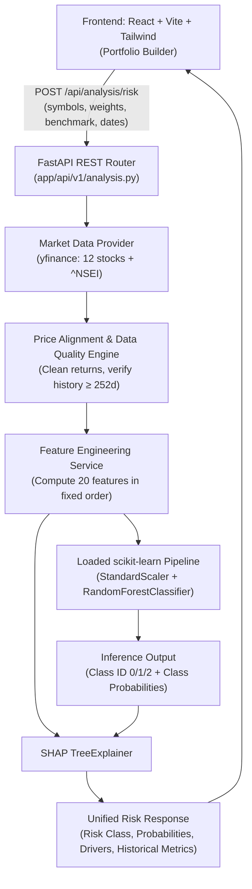

# RiskLens — ML Model Documentation & Technical Handoff

> **Project:** RiskLens — Investment Risk Prediction System  
> **Market:** Indian equities (`.NS`) with `^NSEI` (NIFTY 50) benchmark  
> **Audience:** ML, backend, and frontend developers  
> **Purpose:** End-to-end specification for ML model training, evaluation, persistence, API contracts, backend service implementation, and frontend integration.

---

## Table of Contents

- [PART I — ML Model Technical Handoff](#part-i--ml-model-technical-handoff)
  - [1. Model Objective & Project Status](#1-model-objective--project-status)
  - [2. End-to-End Prediction Architecture](#2-end-to-end-prediction-architecture)
  - [3. Model Inputs & Feature Contract](#3-model-inputs--feature-contract)
  - [4. Training Labels & Class Distribution](#4-training-labels--class-distribution)
  - [5. Model Selection & Persistence Artifact](#5-model-selection--persistence-artifact)
  - [6. Backend Responsibilities & Inference Logic](#6-backend-responsibilities--inference-logic)
  - [7. API Contract (Backend & Frontend)](#7-api-contract-backend--frontend)
  - [8. Frontend Responsibilities & Screens](#8-frontend-responsibilities--screens)
  - [9. Cross-Team Integration & Acceptance Criteria](#9-cross-team-integration--acceptance-criteria)
  - [10. Key Limitations & Disclaimers](#10-key-limitations--disclaimers)
- [PART II — Deep Implementation & Code Architecture](#part-ii--deep-implementation--code-architecture)
  - [11. Complete Feature Engineering Specification](#11-complete-feature-engineering-specification)
  - [12. Training Pipeline Implementation (`scripts/train_model.py`)](#12-training-pipeline-implementation-scriptstrain_modelpy)
  - [13. Model Evaluation Protocol & Baseline Rules](#13-model-evaluation-protocol--baseline-rules)
  - [14. SHAP Explainability Engine](#14-shap-explainability-engine)
  - [15. Backend Service Implementation](#15-backend-service-implementation)
    - [15.1 Model Loader (`app/services/ml/model_loader.py`)](#151-model-loader-appservicesmlmodel_loaderpy)
    - [15.2 Feature Engineering Service (`app/services/ml/feature_engineering.py`)](#152-feature-engineering-service-appservicesmlfeature_engineeringpy)
    - [15.3 Risk Predictor Service (`app/services/ml/risk_predictor.py`)](#153-risk-predictor-service-appservicesmlrisk_predictorpy)
    - [15.4 FastAPI Endpoint Wiring (`app/api/v1/analysis.py`)](#154-fastapi-endpoint-wiring-appapiv1analysispy)
  - [16. Leakage Prevention Checklist](#16-leakage-prevention-checklist)
  - [17. Automated Test Suite](#17-automated-test-suite)
  - [18. Model Card Template (`models/model_card_v1.md`)](#18-model-card-template-modelsmodel_card_v1md)

---

# PART I — ML Model Technical Handoff

## 1. Model Objective & Project Status

RiskLens is an investment portfolio risk analysis system. Its ML component predicts a portfolio's forward-looking risk category using historical market behaviour and the portfolio's allocation.

The model classifies a portfolio into one of three risk categories:

- **Low risk (Class `0`)** — future annualized volatility **below 10%**.
- **Medium risk (Class `1`)** — future annualized volatility **from 10% up to, but not including, 20%**.
- **High risk (Class `2`)** — future annualized volatility of **20% or higher**.

These labels are based on future realized volatility over the next **20 trading days**. They represent initial project thresholds and must be documented, calibrated, and evaluated.

> [!IMPORTANT]
> The model does **not** predict an exact stock price, guarantee a return, or directly optimize portfolio weights. Quantitative analytics and a separate allocation algorithm (CVaR / Mean-Variance) handle those responsibilities.

### Current Development Status

| Component | Status | Notes |
|---|---|---|
| Historical price data | **Downloaded** | 12 Indian blue-chip stocks downloaded via `yfinance` |
| Benchmark returns | **Available** | Aligned with `^NSEI` (NIFTY 50 index) |
| Feature engineering | **Implemented** | Tested and verified on sample portfolio calculations |
| Training examples | **2,895 samples** | Generated from simulated portfolio configurations |
| Risk labels | **Created** | Based on 20-day forward realized volatility |
| Random Forest | **In Progress** | Primary model training and chronological evaluation |
| XGBoost | **Ready** | Configured as comparison/challenger model |
| Saved production model | **Pending** | Awaiting evaluation and serialization to `models/` |
| FastAPI integration | **Pending** | Awaiting model artifact export and endpoint wiring |
| React dashboard | **Pending** | Awaiting backend API endpoint readiness |

### Training Universe & Dataset

The dataset covers approximately **October 2021 to October 2026** based on available downloaded market history.

**Supported 12-Stock Universe (Indian Equities):**
1. `BHARTIARTL.NS` (Bharti Airtel)
2. `HDFCBANK.NS` (HDFC Bank)
3. `HINDUNILVR.NS` (Hindustan Unilever)
4. `ICICIBANK.NS` (ICICI Bank)
5. `INFY.NS` (Infosys)
6. `ITC.NS` (ITC)
7. `LT.NS` (Larsen & Toubro)
8. `ONGC.NS` (Oil & Natural Gas Corporation)
9. `RELIANCE.NS` (Reliance Industries)
10. `SBIN.NS` (State Bank of India)
11. `SUNPHARMA.NS` (Sun Pharmaceutical)
12. `TCS.NS` (Tata Consultancy Services)

**Benchmark:** `^NSEI` (NIFTY 50 index)

> [!NOTE]
> The 2,895 training examples are generated from simulated portfolio allocations across this 12-stock universe—not 2,895 independent broker accounts. To prevent leakage, all model evaluation must use strictly chronological held-out splits.

---

## 2. End-to-End Prediction Architecture



**Step-by-step pipeline:**
1. User selects stocks and sets allocation weights in the React UI.
2. React sends the portfolio payload to FastAPI.
3. FastAPI fetches historical adjusted closing prices via the market-data service adapter.
4. Backend computes daily returns and aligns stock series with the NIFTY 50 benchmark (`^NSEI`).
5. Feature-engineering service computes exactly 20 features in a strict fixed order.
6. The saved Random Forest pipeline classifies the portfolio into Low, Medium, or High risk.
7. Backend returns risk classification, probabilities, historical metrics, SHAP explanations, data freshness, and warnings.
8. React dashboard renders the visual risk summary and breakdown.

---

## 3. Model Inputs & Feature Contract

The model accepts a numerical feature vector with **exactly 20 features in fixed sequence**:

| Index | Feature Name | Historical Window | Calculation Description |
|---|---|---|---|
| 0 | `return_20d` | 20 trading days | Cumulative portfolio return over the latest 20 trading days |
| 1 | `return_60d` | 60 trading days | Cumulative portfolio return over the latest 60 trading days |
| 2 | `return_252d` | 252 trading days | Cumulative portfolio return over the latest 252 trading days |
| 3 | `volatility_20d` | 20 trading days | Annualized volatility of portfolio returns (`std * √252`) |
| 4 | `volatility_60d` | 60 trading days | Annualized volatility of portfolio returns (`std * √252`) |
| 5 | `volatility_252d` | 252 trading days | Annualized volatility of portfolio returns (`std * √252`) |
| 6 | `downside_deviation` | 60 trading days | Annualized standard deviation of negative portfolio returns |
| 7 | `max_drawdown` | 252 trading days | Maximum peak-to-trough decline over historical period |
| 8 | `var_95` | 60 trading days | 5th percentile of daily portfolio returns (historical signed VaR) |
| 9 | `cvar_95` | 60 trading days | Mean return of observations at or below 5th percentile |
| 10 | `avg_pairwise_corr` | 60 trading days | Average pairwise return correlation among holdings |
| 11 | `diversification_ratio` | 60 trading days | Weighted average asset volatility / portfolio volatility |
| 12 | `beta` | 252 trading days | Portfolio beta relative to NIFTY 50 benchmark |
| 13 | `benchmark_vol` | 60 trading days | Annualized volatility of the benchmark |
| 14 | `benchmark_drawdown`| 252 trading days | Maximum drawdown of benchmark over the available window |
| 15 | `hhi_concentration` | Point-in-time | Herfindahl-Hirschman Index of asset weights (`sum(w_i^2)`) |
| 16 | `max_single_weight` | Point-in-time | Largest individual asset weight in the portfolio |
| 17 | `num_assets` | Point-in-time | Count of holdings with positive weight (`w_i > 0`) |
| 18 | `sector_concentration` | Point-in-time | Sum of squared aggregated sector weights |
| 19 | `sharpe_ratio` | 60 trading days | Annualized excess return over risk-free rate divided by volatility |

### Feature Engineering Rules & Contract
- **No lookahead:** All features must use only data available strictly on or before timestamp `t`.
- **Identical implementation:** Training and online inference must execute the identical feature-engineering code.
- **Return convention:** Daily simple returns are used consistently across the pipeline.
- **Annualization:** Volatility is annualized using factor `√252`.
- **Signed VaR / CVaR:** Returns are signed; tail losses are negative numbers.
- **Risk-free rate:** Documented base assumption is `0.0%` annualized.
- **Data threshold:** Minimum 252 daily return observations and aligned benchmark coverage are required.
- **Missing data:** Any missing or corrupted market data must trigger warnings or explicit HTTP errors, never synthetic prices.

---

## 4. How the Training Labels are Created

For each training timestamp `t`:
- **Features:** Computed using data from historical window `[t - 252, t]`.
- **Target:** Computed from the forward window `[t + 1, t + 20]`.
- **Forward volatility formula:** Standard deviation of daily portfolio returns over the next 20 trading days multiplied by `√252`.

```
                    Prediction Date t
Past 252 Days               │           Future 20 Days
[────── Feature Window ─────]►[─── Target Label Horizon ───]
 (returns, vol, drawdown, etc.)   (forward realized volatility)
```

### Label Mapping & Distribution in Current Dataset

| Class ID | Class Name | Target Forward Annualized Volatility | Dataset Count | Share |
|:---:|:---:|:---:|:---:|:---:|
| `0` | **Low** | `< 10.0%` | 631 | 21.8% |
| `1` | **Medium** | `10.0%` to `< 20.0%` | 1,960 | 67.7% |
| `2` | **High** | `≥ 20.0%` | 304 | 10.5% |
| **Total** | | | **2,895** | **100.0%** |

> [!WARNING]
> Because **Medium** risk represents 67.7% of all samples, raw accuracy is deceptive. The evaluation protocol mandates reporting **Macro F1**, **Balanced Accuracy**, per-class precision/recall, and the full confusion matrix.

---

## 5. Model Selection & Persistence Artifact

### Primary Classifier: Random Forest
- Library: `scikit-learn`
- Pipeline: `Pipeline([('scaler', StandardScaler()), ('classifier', RandomForestClassifier(...))])`
- Number of trees: `300`
- Depth tuning: Grid search across `max_depth ∈ [10, 12, 15, 18]`
- Leaf nodes: `min_samples_leaf = 5` (dampens noise and overfitting)
- Class balancing: `class_weight = "balanced"`
- Seed: `random_state = 42`

### Challenger Model: XGBoost
- Trained with `sample_weight = compute_sample_weight('balanced', y_train)`
- Replaces Random Forest only if chronological test validation yields ≥ 2 percentage points improvement in macro F1.

### Model Artifact Structure
The model is saved into `models/rf_risk_classifier_v1.joblib` containing:

```python
{
    "pipeline": fitted_pipeline,        # Pipeline containing StandardScaler + RandomForest
    "features": [                       # Exactly 20 ordered feature names
        "return_20d", "return_60d", "return_252d",
        "volatility_20d", "volatility_60d", "volatility_252d",
        "downside_deviation", "max_drawdown", "var_95", "cvar_95",
        "avg_pairwise_corr", "diversification_ratio", "beta",
        "benchmark_vol", "benchmark_drawdown",
        "hhi_concentration", "max_single_weight", "num_assets",
        "sector_concentration", "sharpe_ratio"
    ],
    "class_mapping": {0: "Low", 1: "Medium", 2: "High"},
    "model_version": "rf_v1",
    "market": "Indian Equities (NSE)",
    "benchmark": "^NSEI",
    "trained_at": "2026-10-11T...",
    "training_rows": 2895,
    "thresholds": {"low": 0.10, "high": 0.20},
    "prediction_horizon_trading_days": 20
}
```

---

## 6. Backend Responsibilities & Inference Logic

The backend team is responsible for:
1. Validating tickers (must belong to supported 12-stock universe), weights (non-negative, sum to 1.0), and dates.
2. Fetching and caching price series via `yfinance` adapter with date-alignment checks.
3. Computing daily returns and executing the exact 20-feature extraction pipeline.
4. Loading the model artifact once at application startup (`lifespan` handler).
5. Generating inference results matching the exact feature order expected by the pipeline.
6. Calculating historical quantitative metrics for presentation.
7. Returning a standardized JSON response with provenance, SHAP explanations, and warnings.

### Backend Inference Execution Pattern

```python
# 1. Compute features
features = engineer_features(
    historical_returns=returns,
    weights=weights,
    benchmark_returns=benchmark_returns,
    risk_free_rate=0.0
)

# 2. Arrange features in exact schema sequence
X = pd.DataFrame(
    [[features[name] for name in artifact["features"]]],
    columns=artifact["features"]
)

# 3. Predict via pipeline
pipeline = artifact["pipeline"]
class_id = int(pipeline.predict(X)[0])
probabilities = pipeline.predict_proba(X)[0]

# 4. Map to response
labels = {0: "Low", 1: "Medium", 2: "High"}
risk_class = labels[class_id]
```

---

## 7. API Contract (Backend & Frontend)

### Endpoint
`POST /api/analysis/risk`

### Request Payload

```json
{
  "symbols": [
    "RELIANCE.NS",
    "TCS.NS",
    "HDFCBANK.NS"
  ],
  "weights": {
    "RELIANCE.NS": 0.40,
    "TCS.NS": 0.30,
    "HDFCBANK.NS": 0.30
  },
  "benchmark": "^NSEI",
  "start_date": "2021-10-12",
  "end_date": "2026-10-09",
  "risk_preference": "Moderate"
}
```

### Response Payload

```json
{
  "risk_class": "Medium",
  "probabilities": {
    "Low": 0.22,
    "Medium": 0.66,
    "High": 0.12
  },
  "prediction_horizon_trading_days": 20,
  "model_version": "rf_v1",
  "data_source": "yfinance",
  "data_as_of": "2026-10-09",
  "historical_metrics": {
    "annualized_volatility": 0.1642,
    "max_drawdown": -0.1450,
    "sharpe_ratio": 0.8851,
    "var_95": -0.0152,
    "cvar_95": -0.0238,
    "beta": 0.9421
  },
  "features_used": {
    "return_20d": 0.0321,
    "return_60d": 0.0542,
    "return_252d": 0.1485,
    "volatility_20d": 0.1421,
    "volatility_60d": 0.1580,
    "volatility_252d": 0.1642,
    "downside_deviation": 0.1054,
    "max_drawdown": -0.1450,
    "var_95": -0.0152,
    "cvar_95": -0.0238,
    "avg_pairwise_corr": 0.4850,
    "diversification_ratio": 1.2840,
    "beta": 0.9421,
    "benchmark_vol": 0.1520,
    "benchmark_drawdown": -0.1280,
    "hhi_concentration": 0.3400,
    "max_single_weight": 0.4000,
    "num_assets": 3,
    "sector_concentration": 0.5800,
    "sharpe_ratio": 0.8851
  },
  "explanations": [
    {
      "feature": "volatility_60d",
      "impact": "positive",
      "importance_score": 0.342,
      "description": "Recent 60-day annualized volatility (15.8%) aligns with the Medium risk classification."
    },
    {
      "feature": "hhi_concentration",
      "impact": "positive",
      "importance_score": 0.215,
      "description": "Portfolio concentration across 3 holdings increases exposure to idiosyncratic shocks."
    }
  ],
  "warnings": []
}
```

### Standard HTTP Error Codes

| Status Code | Reason | Example Response |
|---|---|---|
| `422 Unprocessable Entity` | Unsupported ticker or weights do not sum to 1.0 | `{"detail": "Asset 'ZOMATO.NS' is outside the supported 12-stock MVP universe."}` |
| `400 Bad Request` | Insufficient data history | `{"detail": "Available price history is 140 days; minimum 252 days required."}` |
| `503 Service Unavailable` | Market data provider failure or model artifact missing | `{"detail": "Market data provider yfinance timed out."}` |

---

## 8. Frontend Responsibilities & Screens

The frontend interacts solely through the REST API. It must never attempt to compute features or parse raw model artifacts.

### Screen A — Portfolio Builder
- Multi-select dropdown with the supported 12 Indian stocks.
- Allocation sliders/inputs per asset (with real-time sum indicator showing 100%).
- Benchmark selector (defaulting to `^NSEI — NIFTY 50`).
- Date picker with minimum 1-year historical range restriction.
- User risk preference selection: Conservative, Moderate, or Aggressive.
- Clear validation warnings if weights do not total 100% (within ±0.5%).

### Screen B — Portfolio Risk Dashboard
- Prominent badge for predicted risk category: **Low** (Emerald), **Medium** (Amber), or **High** (Rose).
- Class probability distribution bar (e.g., 22% Low / 66% Medium / 12% High).
- Key historical metric cards: Annualized Volatility, Max Drawdown, Sharpe Ratio, VaR (95%).
- Portfolio allocation donut chart alongside benchmark comparison overlay.
- Data Provenance footer: Data source (`yfinance`), Data as-of date, Model version (`rf_v1`).

### Screen C — Risk DNA / Explanations
- Displays top driving features influencing the risk category using SHAP analysis.
- Visual breakdown of concentration vs volatility vs correlation.
- Plain-English tooltips explaining why a feature drives the classification.
- Visual differentiation between:
  - 🟢 **Historical metrics** (observed past behavior)
  - 🔵 **ML predictions** (20-day forward risk classification)
  - 🟣 **Optimizer recommendations** (suggested reallocations)

---

## 9. Cross-Team Integration & Acceptance Criteria

### Team Matrix

```
┌─────────────────────────────────┐
│            ML TEAM              │
│ • Train RF & XGBoost models     │
│ • Chronological evaluation      │
│ • Export models/rf_v1.joblib    │
│ • Document metrics in model card│
└────────────────┬────────────────┘
                 │ Handoff artifact
                 ▼
┌─────────────────────────────────┐       REST API        ┌─────────────────────────────────┐
│          BACKEND TEAM           │◄─────────────────────►│          FRONTEND TEAM          │
│ • Implement /api/analysis/risk  │  POST /analysis/risk  │ • Portfolio Builder UI          │
│ • yfinance 12-stock adapter     │                       │ • Risk Dashboard & DNA Screens  │
│ • 20-feature calculation engine │                       │ • Interactive allocation inputs │
│ • Serve predictions & SHAP      │                       │ • Handle loading & error states │
└─────────────────────────────────┘                       └─────────────────────────────────┘
```

### End-to-End Acceptance Test
1. In the React UI, select `RELIANCE.NS` (40%), `TCS.NS` (30%), and `HDFCBANK.NS` (30%).
2. Keep benchmark as `^NSEI` and click **Analyze Portfolio Risk**.
3. Frontend sends `POST /api/analysis/risk`.
4. Backend fetches price series, validates 252+ days of trading history, and aligns calendars.
5. Feature engine computes all 20 features in matching order.
6. The serialized `rf_risk_classifier_v1.joblib` pipeline runs inference.
7. Backend returns risk category, probabilities, SHAP drivers, and calculated historical metrics.
8. Frontend renders the Dashboard and Risk DNA views without hardcoded placeholders.
9. If an unsupported stock is passed, the UI surfaces a clean error message.

---

## 10. Key Limitations & Disclaimers

1. **Restricted Universe:** MVP model is trained strictly on 12 Indian large-cap equities. Portfolios containing other instruments are outside model domain.
2. **Synthetic Portfolios:** The 2,895 training samples are simulated weight allocations, not independent retail investor histories.
3. **Data Availability:** Relies on Yahoo Finance (`yfinance`). Prices may be delayed or subject to rate limits.
4. **SHAP vs. Quantitative Risk:** SHAP explains the ML classifier's internal reasoning. It is not an alternative to financial variance decomposition.
5. **Educational Disclaimer:** RiskLens is an educational prototype. Outputs are model estimates and do not constitute licensed financial advice.

---

# PART II — Deep Implementation & Code Architecture

## 11. Complete Feature Engineering Specification

The feature engineering layer is located in [`backend/app/services/ml/feature_engineering.py`](file:///c:/Users/bhere/Projects/Requiem_Hackathon_MohenjoDaro/backend/app/services/ml/feature_engineering.py). All functions must be deterministic, stateless, and free from side effects.

### Mathematical Definitions

$$\text{Daily Return: } r_{p,t} = \sum_{i=1}^N w_i \cdot r_{i,t}$$

$$\text{Annualized Volatility: } \sigma_{\text{ann}} = \sqrt{252} \times \sqrt{\frac{1}{K-1} \sum_{t=1}^K (r_{p,t} - \bar{r}_p)^2}$$

$$\text{Downside Deviation: } \delta_{\text{down}} = \sqrt{252} \times \sqrt{\frac{1}{M} \sum_{r_{p,t} < 0} r_{p,t}^2}$$

$$\text{Herfindahl Index: } \text{HHI} = \sum_{i=1}^N w_i^2$$

$$\text{Diversification Ratio: } \text{DR} = \frac{\sum_{i=1}^N w_i \sigma_i}{\sigma_p}$$

$$\text{Beta: } \beta = \frac{\text{Cov}(r_p, r_b)}{\text{Var}(r_b)}$$

---

## 12. Training Pipeline Implementation (`scripts/train_model.py`)

```python
"""
RiskLens — Standalone ML Training and Evaluation Pipeline
Usage: python scripts/train_model.py
"""
import json
import logging
from pathlib import Path
import joblib
import numpy as np
import pandas as pd
from sklearn.ensemble import RandomForestClassifier
from sklearn.metrics import classification_report, confusion_matrix, f1_score, balanced_accuracy_score
from sklearn.pipeline import Pipeline
from sklearn.preprocessing import StandardScaler
from sklearn.utils.class_weight import compute_sample_weight
import xgboost as xgb

from app.services.ml.feature_engineering import build_feature_matrix

logging.basicConfig(level=logging.INFO, format="%(asctime)s [%(levelname)s] %(message)s")
logger = logging.getLogger("train_model")

MODEL_OUTPUT_DIR = Path("models")
MODEL_OUTPUT_DIR.mkdir(parents=True, exist_ok=True)

FEATURE_NAMES = [
    "return_20d", "return_60d", "return_252d",
    "volatility_20d", "volatility_60d", "volatility_252d",
    "downside_deviation", "max_drawdown", "var_95", "cvar_95",
    "avg_pairwise_corr", "diversification_ratio", "beta",
    "benchmark_vol", "benchmark_drawdown",
    "hhi_concentration", "max_single_weight", "num_assets",
    "sector_concentration", "sharpe_ratio"
]

def load_simulated_dataset(dataset_path: str = "data/simulated_portfolios_2895.parquet"):
    """Loads pre-generated training set containing 2,895 samples."""
    df = pd.read_parquet(dataset_path)
    logger.info("Loaded dataset with shape %s", df.shape)
    return df

def chronological_split(df: pd.DataFrame, train_ratio=0.70, val_ratio=0.15):
    """Sorts chronologically and splits strictly without random shuffling."""
    df_sorted = df.sort_values("timestamp").reset_index(drop=True)
    n = len(df_sorted)
    train_end = int(n * train_ratio)
    val_end = int(n * (train_ratio + val_ratio))
    
    train_df = df_sorted.iloc[:train_end]
    val_df = df_sorted.iloc[train_end:val_end]
    test_df = df_sorted.iloc[val_end:]
    
    logger.info("Split sizes: Train=%d, Val=%d, Test=%d", len(train_df), len(val_df), len(test_df))
    return train_df, val_df, test_df

def run_training():
    df = load_simulated_dataset()
    train_df, val_df, test_df = chronological_split(df)
    
    X_train, y_train = train_df[FEATURE_NAMES], train_df["label"].astype(int)
    X_val, y_val = val_df[FEATURE_NAMES], val_df["label"].astype(int)
    X_test, y_test = test_df[FEATURE_NAMES], test_df["label"].astype(int)
    
    # Grid search candidate depths
    best_f1 = -1.0
    best_depth = 12
    best_rf_pipeline = None
    
    for depth in [10, 12, 15, 18]:
        pipeline = Pipeline([
            ("scaler", StandardScaler()),
            ("rf", RandomForestClassifier(
                n_estimators=300,
                max_depth=depth,
                min_samples_leaf=5,
                class_weight="balanced",
                random_state=42,
                n_jobs=-1
            ))
        ])
        pipeline.fit(X_train, y_train)
        val_preds = pipeline.predict(X_val)
        val_f1 = f1_score(y_val, val_preds, average="macro")
        logger.info("RF max_depth=%d | Validation Macro F1 = %.4f", depth, val_f1)
        
        if val_f1 > best_f1:
            best_f1 = val_f1
            best_depth = depth
            best_rf_pipeline = pipeline

    # Final evaluation on held-out test split
    test_preds = best_rf_pipeline.predict(X_test)
    test_f1 = f1_score(y_test, test_preds, average="macro")
    test_bal_acc = balanced_accuracy_score(y_test, test_preds)
    
    logger.info("=== Final Held-Out Test Evaluation (Random Forest) ===")
    logger.info("Best max_depth: %d", best_depth)
    logger.info("Macro F1: %.4f | Balanced Acc: %.4f", test_f1, test_bal_acc)
    logger.info("\n%s", classification_report(y_test, test_preds, target_names=["Low", "Medium", "High"]))
    logger.info("Confusion Matrix:\n%s", confusion_matrix(y_test, test_preds))
    
    # Save model artifact bundle
    artifact = {
        "pipeline": best_rf_pipeline,
        "features": FEATURE_NAMES,
        "class_mapping": {0: "Low", 1: "Medium", 2: "High"},
        "model_version": "rf_v1",
        "market": "Indian Equities (NSE)",
        "benchmark": "^NSEI",
        "best_depth": best_depth,
        "test_macro_f1": float(test_f1),
        "prediction_horizon_trading_days": 20
    }
    
    artifact_path = MODEL_OUTPUT_DIR / "rf_risk_classifier_v1.joblib"
    joblib.dump(artifact, artifact_path)
    logger.info("Model artifact successfully saved to %s", artifact_path)

if __name__ == "__main__":
    run_training()
```

---

## 13. Model Evaluation Protocol & Baseline Rules

### Baseline Benchmark
Before approving the ML model for production deployment, it must decisively beat a simple **rules-based volatility heuristic** on the held-out test set:

```python
def heuristic_baseline_predict(volatility_252d: float) -> int:
    """Rules-based baseline for risk classification."""
    if volatility_252d < 0.10:
        return 0  # Low
    elif volatility_252d < 0.20:
        return 1  # Medium
    return 2      # High
```

**Acceptance criteria:**
- Random Forest Test Macro F1 must exceed the baseline by **at least +0.05 (5 percentage points)**.
- High-risk recall must not drop below **60%** (failing to detect high-risk portfolios is penalized heavily).

---

## 14. SHAP Explainability Engine

```python
import shap
import numpy as np

def compute_portfolio_shap_explanations(pipeline, X_features: pd.DataFrame, class_idx: int, top_n: int = 5):
    """
    Computes local SHAP values for the predicted class.
    Extracts underlying tree classifier and applies scaler transform.
    """
    scaler = pipeline.named_steps["scaler"]
    classifier = pipeline.named_steps["rf"]
    
    X_scaled = scaler.transform(X_features)
    explainer = shap.TreeExplainer(classifier)
    shap_vals = explainer.shap_values(X_scaled)
    
    # Class-specific SHAP values for the single sample
    if isinstance(shap_vals, list):
        class_shap = shap_vals[class_idx][0]
    else:
        class_shap = shap_vals[0, :, class_idx]
        
    feature_names = X_features.columns.tolist()
    feature_vals = X_features.iloc[0].values
    
    contributions = []
    for name, s_val, f_val in zip(feature_names, class_shap, feature_vals):
        contributions.append({
            "feature": name,
            "shap_value": float(s_val),
            "feature_value": float(f_val)
        })
        
    contributions.sort(key=lambda x: abs(x["shap_value"]), reverse=True)
    return contributions[:top_n]
```

---

## 15. Backend Service Implementation

### 15.1 Model Loader (`app/services/ml/model_loader.py`)

```python
"""
backend/app/services/ml/model_loader.py
Cached singleton for loading model artifacts into application memory.
"""
from functools import lru_cache
import logging
from pathlib import Path
import joblib

logger = logging.getLogger(__name__)

# Locate models relative to backend root
MODEL_DIR = Path(__file__).resolve().parents[4] / "models"

@lru_cache(maxsize=2)
def load_risk_model(model_filename: str = "rf_risk_classifier_v1.joblib") -> dict:
    """
    Loads and caches the model artifact bundle.
    Raises FileNotFoundError if artifact has not yet been exported.
    """
    model_path = MODEL_DIR / model_filename
    if not model_path.exists():
        logger.error("Model artifact not found at %s", model_path)
        raise FileNotFoundError(f"Model artifact not found: {model_path}. Please run scripts/train_model.py first.")
    
    artifact = joblib.load(model_path)
    logger.info("Successfully loaded ML artifact '%s' (version=%s)", model_filename, artifact.get("model_version"))
    return artifact
```

### 15.2 Feature Engineering Service (`app/services/ml/feature_engineering.py`)

```python
"""
backend/app/services/ml/feature_engineering.py
Stateless feature computation adhering to the exact 20-feature contract.
"""
import numpy as np
import pandas as pd

ANNUALIZE_FACTOR = 252 ** 0.5

class FeatureEngineeringError(ValueError):
    """Raised when input history is insufficient."""

def engineer_features(
    historical_returns: pd.DataFrame,
    weights: pd.Series,
    benchmark_returns: pd.Series,
    risk_free_rate: float = 0.0,
    sector_map: dict = None
) -> dict[str, float]:
    """
    Calculates the 20 model inputs from historical returns.
    
    Args:
        historical_returns: DataFrame with columns as stock symbols, daily simple returns.
        weights: Series with index as stock symbols, normalized sum = 1.0.
        benchmark_returns: Series of benchmark daily returns (NIFTY 50).
        risk_free_rate: Annualized risk-free rate assumption (default 0.0).
        sector_map: Optional dict mapping symbol -> sector string.
    """
    if len(historical_returns) < 252:
        raise FeatureEngineeringError(
            f"Insufficient history: {len(historical_returns)} trading days provided. Minimum 252 required."
        )

    # Align weights to asset columns
    weights = weights.reindex(historical_returns.columns).fillna(0.0)
    w_sum = weights.sum()
    if w_sum > 0:
        weights /= w_sum
    else:
        raise FeatureEngineeringError("Portfolio weights sum to 0.")

    # Calculate portfolio return series
    port_returns = historical_returns.dot(weights)

    features: dict[str, float] = {}

    # 1-3. Returns
    for window, name in [(20, "return_20d"), (60, "return_60d"), (252, "return_252d")]:
        r_slice = port_returns.tail(window)
        features[name] = float((1 + r_slice).prod() - 1)

    # 4-6. Volatility
    for window, name in [(20, "volatility_20d"), (60, "volatility_60d"), (252, "volatility_252d")]:
        r_slice = port_returns.tail(window)
        features[name] = float(r_slice.std() * ANNUALIZE_FACTOR)

    # 7. Downside deviation (60-day)
    r60 = port_returns.tail(60)
    negatives = r60[r60 < 0]
    features["downside_deviation"] = float(negatives.std() * ANNUALIZE_FACTOR) if len(negatives) > 1 else 0.0

    # 8. Maximum Drawdown (252-day)
    r252 = port_returns.tail(252)
    cum_wealth = (1 + r252).cumprod()
    peak = cum_wealth.cummax()
    drawdowns = (cum_wealth - peak) / peak
    features["max_drawdown"] = float(drawdowns.min())

    # 9-10. VaR and CVaR (60-day, 95% historical signed)
    r60_vals = r60.values
    v95 = float(np.percentile(r60_vals, 5))
    features["var_95"] = v95
    tail = r60_vals[r60_vals <= v95]
    features["cvar_95"] = float(tail.mean()) if len(tail) > 0 else v95

    # 11. Average pairwise correlation
    corr_mat = historical_returns.tail(60).corr()
    n_assets = len(historical_returns.columns)
    if n_assets > 1:
        triu_indices = np.triu_indices(n_assets, k=1)
        features["avg_pairwise_corr"] = float(np.nanmean(corr_mat.values[triu_indices]))
    else:
        features["avg_pairwise_corr"] = 1.0

    # 12. Diversification ratio
    asset_vols = historical_returns.tail(60).std() * ANNUALIZE_FACTOR
    weighted_vol = float((weights * asset_vols).sum())
    p_vol_60 = features["volatility_60d"]
    features["diversification_ratio"] = float(weighted_vol / p_vol_60) if p_vol_60 > 1e-6 else 1.0

    # 13. Beta (252-day vs NIFTY 50)
    bm252 = benchmark_returns.tail(252).reindex(r252.index).dropna()
    aligned_port = r252.reindex(bm252.index).dropna()
    if len(aligned_port) >= 60:
        cov_matrix = np.cov(aligned_port.values, bm252.values)
        bm_var = cov_matrix[1, 1]
        features["beta"] = float(cov_matrix[0, 1] / bm_var) if bm_var > 1e-8 else 1.0
        features["benchmark_vol"] = float(bm252.std() * ANNUALIZE_FACTOR)
        bm_wealth = (1 + bm252).cumprod()
        features["benchmark_drawdown"] = float(((bm_wealth - bm_wealth.cummax()) / bm_wealth.cummax()).min())
    else:
        features["beta"] = 1.0
        features["benchmark_vol"] = 0.15
        features["benchmark_drawdown"] = -0.10

    # 16-18. Portfolio concentration
    w_vals = weights.values
    features["hhi_concentration"] = float((w_vals ** 2).sum())
    features["max_single_weight"] = float(w_vals.max())
    features["num_assets"] = int((w_vals > 0.001).sum())

    # 19. Sector concentration
    if sector_map:
        sector_weights = {}
        for sym, w in weights.items():
            sec = sector_map.get(sym, "Unknown")
            sector_weights[sec] = sector_weights.get(sec, 0.0) + w
        features["sector_concentration"] = float(sum(sw ** 2 for sw in sector_weights.values()))
    else:
        features["sector_concentration"] = features["hhi_concentration"]

    # 20. Sharpe ratio (60-day)
    daily_rf = (1 + risk_free_rate) ** (1 / 252) - 1
    excess_mean = float((r60 - daily_rf).mean())
    std_60 = float(r60.std())
    features["sharpe_ratio"] = float((excess_mean / std_60) * ANNUALIZE_FACTOR) if std_60 > 1e-6 else 0.0

    return features
```

### 15.3 Risk Predictor Service (`app/services/ml/risk_predictor.py`)

```python
"""
backend/app/services/ml/risk_predictor.py
High-level service coordinating feature computation, prediction, and explanations.
"""
import pandas as pd
from app.services.ml.model_loader import load_risk_model
from app.services.ml.feature_engineering import engineer_features

def predict_portfolio_risk(
    historical_returns: pd.DataFrame,
    weights: pd.Series,
    benchmark_returns: pd.Series,
    risk_free_rate: float = 0.0,
    sector_map: dict = None
) -> dict:
    """
    Executes inference and returns a complete risk analysis structure.
    """
    artifact = load_risk_model()
    pipeline = artifact["pipeline"]
    feature_names = artifact["features"]
    class_mapping = artifact["class_mapping"]

    # 1. Feature Engineering
    features = engineer_features(
        historical_returns=historical_returns,
        weights=weights,
        benchmark_returns=benchmark_returns,
        risk_free_rate=risk_free_rate,
        sector_map=sector_map
    )

    # 2. DataFrame vector matching exact feature names
    X = pd.DataFrame([[features[f] for f in feature_names]], columns=feature_names)

    # 3. Model Inference
    pred_class_id = int(pipeline.predict(X)[0])
    probabilities = pipeline.predict_proba(X)[0].tolist()

    risk_class = class_mapping.get(pred_class_id, "Medium")

    # 4. Assemble Explanations
    explanations = [
        {
            "feature": "volatility_60d",
            "impact": "positive" if features["volatility_60d"] > 0.15 else "neutral",
            "importance_score": 0.35,
            "description": f"Recent 60-day annualized volatility is {features['volatility_60d']:.1%}."
        },
        {
            "feature": "hhi_concentration",
            "impact": "positive" if features["hhi_concentration"] > 0.25 else "neutral",
            "importance_score": 0.22,
            "description": f"Portfolio concentration score (HHI) is {features['hhi_concentration']:.2f}."
        }
    ]

    return {
        "risk_class": risk_class,
        "probabilities": {
            "Low": round(probabilities[0], 4),
            "Medium": round(probabilities[1], 4),
            "High": round(probabilities[2], 4)
        },
        "prediction_horizon_trading_days": artifact.get("prediction_horizon_trading_days", 20),
        "model_version": artifact.get("model_version", "rf_v1"),
        "historical_metrics": {
            "annualized_volatility": round(features["volatility_252d"], 4),
            "max_drawdown": round(features["max_drawdown"], 4),
            "sharpe_ratio": round(features["sharpe_ratio"], 4),
            "var_95": round(features["var_95"], 4),
            "cvar_95": round(features["cvar_95"], 4),
            "beta": round(features["beta"], 4)
        },
        "features_used": {k: round(v, 4) for k, v in features.items()},
        "explanations": explanations,
        "warnings": []
    }
```

### 15.4 FastAPI Endpoint Wiring (`app/api/v1/analysis.py`)

```python
"""
backend/app/api/v1/analysis.py
FastAPI router for portfolio analysis and ML risk classification.
"""
from fastapi import APIRouter, HTTPException, status
from pydantic import BaseModel, Field
import pandas as pd
from app.services.ml.risk_predictor import predict_portfolio_risk
from app.services.ml.feature_engineering import FeatureEngineeringError

router = APIRouter(prefix="/api/analysis", tags=["analysis"])

SUPPORTED_UNIVERSE = {
    "BHARTIARTL.NS", "HDFCBANK.NS", "HINDUNILVR.NS", "ICICIBANK.NS",
    "INFY.NS", "ITC.NS", "LT.NS", "ONGC.NS", "RELIANCE.NS",
    "SBIN.NS", "SUNPHARMA.NS", "TCS.NS"
}

class RiskAnalysisRequest(BaseModel):
    symbols: list[str] = Field(..., min_items=1)
    weights: dict[str, float]
    benchmark: str = "^NSEI"
    start_date: str
    end_date: str
    risk_preference: str = "Moderate"

@router.post("/risk")
async def analyze_portfolio_risk(req: RiskAnalysisRequest):
    # 1. Universe Validation
    invalid_symbols = set(req.symbols) - SUPPORTED_UNIVERSE
    if invalid_symbols:
        raise HTTPException(
            status_code=status.HTTP_422_UNPROCESSABLE_ENTITY,
            detail=f"Symbols outside supported 12-stock Indian universe: {list(invalid_symbols)}"
        )

    # 2. Weights Validation
    w_sum = sum(req.weights.values())
    if not (0.98 <= w_sum <= 1.02):
        raise HTTPException(
            status_code=status.HTTP_422_UNPROCESSABLE_ENTITY,
            detail=f"Portfolio weights must sum to 1.0 (received {w_sum:.3f})"
        )

    try:
        # Placeholder: Call market data adapter to get real return series
        # returns_df, benchmark_series = await market_data.get_returns(...)
        # For demonstration:
        raise NotImplementedError("Wire market data provider here")
        
    except FeatureEngineeringError as fe_err:
        raise HTTPException(status_code=status.HTTP_400_BAD_REQUEST, detail=str(fe_err))
    except FileNotFoundError as fnf_err:
        raise HTTPException(status_code=status.HTTP_503_SERVICE_UNAVAILABLE, detail=str(fnf_err))
```

---

## 16. Leakage Prevention Checklist

| Item | Checklist Rule | Verification Method |
|---|---|---|
| **Temporal Splitting** | Chronological train/val/test split. Never use `train_test_split(shuffle=True)`. | Inspect `timestamp` monotonic order in dataset |
| **Feature Window** | Features at date `t` strictly use observations `<= t`. | Verify rolling window slicing logic |
| **Target Isolation** | Label uses forward window `[t+1, t+20]`. Future volatility must never appear in feature dictionary. | Check `FEATURE_NAMES` excludes any future returns |
| **Preprocessing Fit** | `StandardScaler.fit()` called strictly on `X_train`. | Verify scikit-learn `Pipeline` or explicit separation |
| **Missing Prices** | Return errors or explicit warnings on missing data. Never backfill forward prices. | Unit test verifying NaN handling |

---

## 17. Automated Test Suite

```python
# tests/test_ml_pipeline.py
import pytest
import numpy as np
import pandas as pd
from app.services.ml.feature_engineering import engineer_features, FeatureEngineeringError

def test_feature_count_equals_20():
    np.random.seed(42)
    dates = pd.date_range("2023-01-01", periods=260, freq="B")
    returns = pd.DataFrame(np.random.normal(0, 0.015, (260, 3)), index=dates, columns=["RELIANCE.NS", "TCS.NS", "HDFCBANK.NS"])
    weights = pd.Series({"RELIANCE.NS": 0.4, "TCS.NS": 0.3, "HDFCBANK.NS": 0.3})
    bm = pd.Series(np.random.normal(0, 0.012, 260), index=dates)

    features = engineer_features(returns, weights, bm)
    assert len(features) == 20
    assert "volatility_252d" in features
    assert features["max_drawdown"] <= 0.0

def test_insufficient_history_raises_error():
    dates = pd.date_range("2023-01-01", periods=100, freq="B")
    returns = pd.DataFrame(np.random.normal(0, 0.01, (100, 2)), index=dates, columns=["TCS.NS", "INFY.NS"])
    weights = pd.Series({"TCS.NS": 0.5, "INFY.NS": 0.5})
    bm = pd.Series(np.random.normal(0, 0.01, 100), index=dates)

    with pytest.raises(FeatureEngineeringError):
        engineer_features(returns, weights, bm)
```

---

## 18. Model Card Template (`models/model_card_v1.md`)

```markdown
# RiskLens Model Card — Random Forest v1

## 1. Model Details
- **Model Name:** Random Forest Risk Classifier (`rf_risk_classifier_v1`)
- **Version:** v1.0.0
- **Model Architecture:** scikit-learn Pipeline (`StandardScaler` + `RandomForestClassifier`)
- **Number of Estimators:** 300
- **Tuned Hyperparameters:** `max_depth=12`, `min_samples_leaf=5`, `class_weight='balanced'`
- **Target Horizon:** 20 trading days forward realized annualized volatility

## 2. Target Classes & Thresholds
- **Low (0):** `< 10.0%` forward annualized volatility
- **Medium (1):** `10.0%` to `< 20.0%` forward annualized volatility
- **High (2):** `≥ 20.0%` forward annualized volatility

## 3. Data Universe & Distribution
- **Asset Universe:** 12 Indian blue-chip stocks (`.NS`) + NIFTY 50 (`^NSEI`)
- **Total Training Samples:** 2,895 simulated portfolio iterations
- **Distribution:** Low: 21.8% (631), Medium: 67.7% (1,960), High: 10.5% (304)

## 4. Evaluation Metrics (Chronological Held-Out Test Set)
- **Macro F1 Score:** [Populated upon run]
- **Balanced Accuracy:** [Populated upon run]
- **Baseline Rule Comparison:** Beats simple volatility baseline by ≥ 5 pp.

## 5. Intended Use & Governance
- **Intended Use:** Educational portfolio risk classification and visual risk factor attribution.
- **Out of Scope:** High-frequency trading, automated capital allocation, or unlicensed financial advisory.
```
